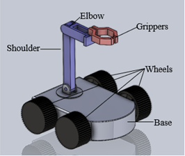
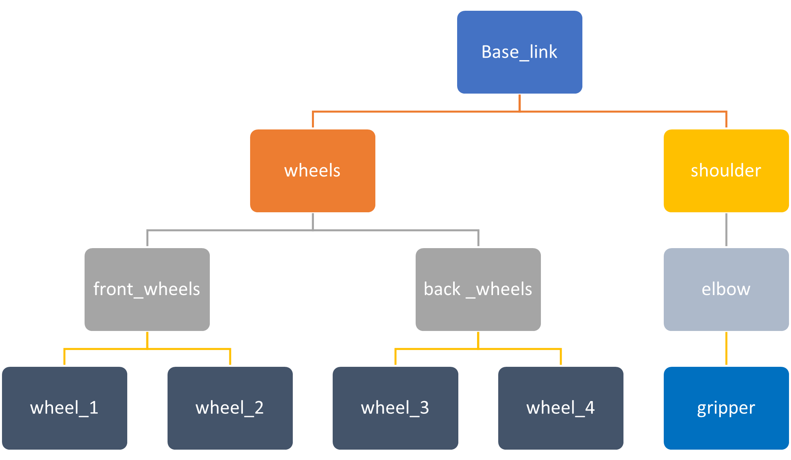
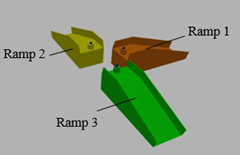
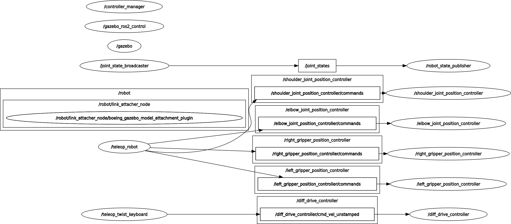

# Differential-Drive Mobile Manipulator for Pickup and Sorting (ROS 2, Gazebo)

Simulation package for a four-wheel differential-drive robot with a two-joint arm and a two-finger gripper, designed for industrial pick-and-place and sorting. The robot was modelled in SolidWorks, exported to the Unified Robot Description Format (URDF), and tested in Gazebo with `ros2_control`. The tests covered driving, ramps with different floor friction, and picking up and placing cubes by keyboard teleoperation.

This repository holds the simulation framework for the paper:

> A. Pothula, V. Medhini, H. Hakkim and R. K. Megalingam, "Design and Implementation of a Differential Drive Manipulator Robot for Industrial Pickup and Sorting Applications Using ROS2," *2025 International Conference on Robotics and Mechatronics (ICRM)*.



---

## Contents

- [The robot](#the-robot)
- [Simulation scene](#simulation-scene)
- [Software architecture](#software-architecture)
- [Requirements](#requirements)
- [Build](#build)
- [Run](#run)
- [Repository layout](#repository-layout)
- [Notes](#notes)
- [Citation](#citation)

---

## The robot

| Part | Details |
|---|---|
| Base | 4 wheels, driven as a differential drive (left: `wheel_1`, `wheel_3`; right: `wheel_2`, `wheel_4`); wheel radius 0.04 m, track width 0.286 m |
| Arm | `shoulder_joint` (−80° to +60°) and `elbow_joint` (−150° to −50°) |
| Gripper | `left_gripper_joint` (0° to 60°) and `right_gripper_joint` (−60° to 0°) |
| Control | `gazebo_ros2_control` at 100 Hz: one `diff_drive_controller` and four position controllers |



---

## Simulation scene

`robot.launch.py` starts Gazebo with an empty world and spawns the following:

- the robot at the origin;
- three ramps around a raised platform at y = 5 m, each with a different floor friction coefficient:

  | Model | Friction (μ) |
  |---|---|
  | `ramp_pol` (polished) | 0.6 |
  | `ramp_conc` (concrete) | 0.9 |
  | `ramp_rubber` (rubber) | 1.3 |

- after 5 s, three 64 mm, 113 g cubes (`cube1`, `cube2` and `cube3`) on top of the platform.



Objects are "grasped" with the [Boeing Gazebo Model Attachment Plugin](https://github.com/boeing/gazebo_model_attachment_plugin). It is loaded by the world file, and it adds a fixed joint between the right gripper and a cube while the cube is held, and removes the joint again on release.

---

## Software architecture



| Node | Role |
|---|---|
| `controller_manager` | Loads the controllers in `config/robot_controllers.yaml` |
| `diff_drive_controller` | Takes `geometry_msgs/Twist` on `/diff_drive_controller/cmd_vel_unstamped` and publishes odometry with the `odom → base_link` transform |
| `shoulder_joint_position_controller`, `elbow_joint_position_controller`, `left_gripper_position_controller`, `right_gripper_position_controller` | Joint position commands (`std_msgs/Float64MultiArray` on `/<controller>/commands`) |
| `joint_state_broadcaster` → `robot_state_publisher` | Joint states and the TF tree |
| `teleop_robot` (`custom_teleop`) | Keyboard control of the arm and gripper; calls `/gazebo/attach` and `/gazebo/detach` |
| `teleop_twist_keyboard` | Keyboard driving of the base |

---

## Requirements

- Ubuntu 22.04, ROS 2 Humble, Gazebo 11 (Classic)
- `gazebo_ros_pkgs`, `ros2_control`, `gazebo_ros2_control`, `ros2_controllers` and `teleop_twist_keyboard`:
  ```bash
  sudo apt install ros-humble-gazebo-ros-pkgs ros-humble-ros2-control \
      ros-humble-gazebo-ros2-control ros-humble-ros2-controllers ros-humble-teleop-twist-keyboard
  ```
- The Boeing attachment plugin. It is included as a Git submodule pinned to commit `9f92782`, so clone with `--recursive`. See the plugin's own README for its build notes.

## Build

> **The workspace must live at `/home/adithya/ros2_ws`, or the paths must be changed.** The URDFs, the controller-parameter path in `robot.urdf` and the plugin path in `worlds/empty_world.sdf` are absolute paths under `/home/adithya/ros2_ws`. On another machine, rewrite them to your own workspace after cloning (the command is in the block below).

```bash
git clone --recursive https://github.com/adithya2204/ros2-mobile-manipulator-sorting.git
cd ros2-mobile-manipulator-sorting/ros2_ws

# Only if your workspace is not /home/adithya/ros2_ws:
grep -rl "/home/adithya/ros2_ws" src/object_spawner | xargs sed -i "s#/home/adithya/ros2_ws#$PWD#g"

rosdep install --from-paths src --ignore-src -y
colcon build
source install/setup.bash
```

---

## Run

Use one terminal per command, each with the workspace sourced.

```bash
# 1. Gazebo, robot, ramps, cubes and controllers
ros2 launch object_spawner robot.launch.py

# 2. Drive the base
ros2 run teleop_twist_keyboard teleop_twist_keyboard \
    --ros-args -r /cmd_vel:=/diff_drive_controller/cmd_vel_unstamped

# 3. Arm, gripper and pick/place
ros2 run custom_teleop teleop_arm_node
```

**Arm teleop keys** (`teleop_arm_node`):

| Key | Action |
|---|---|
| `w` / `s` | shoulder ± 0.1 rad |
| `e` / `d` | elbow ± 0.1 rad |
| `r` / `f` | gripper open / close |
| `1` `2` `3` | close the gripper and attach `cube1` / `cube2` / `cube3` |
| `!` `@` `#` | open the gripper and detach `cube1` / `cube2` / `cube3` |
| `space` | reset the arm and gripper to the default pose |
| `h` / `q` | help / quit |

**Attaching and detaching by hand** (what keys `1` and `!` do):

```bash
ros2 service call /gazebo/attach boeing_gazebo_model_attachment_plugin_msgs/srv/Attach \
  "{joint_name: 'right_gripper_cylinder_joint', model_name_1: 'robot', link_name_1: 'right_gripper', model_name_2: 'cube1', link_name_2: 'cube'}"

ros2 service call /gazebo/detach boeing_gazebo_model_attachment_plugin_msgs/srv/Detach \
  "{joint_name: 'right_gripper_cylinder_joint', model_name_1: 'robot', model_name_2: 'cube1'}"
```

---

## Repository layout

```
ros2-mobile-manipulator-sorting/
├── images/                      # figures used in this README
├── manbot/                      # SolidWorks parts, assembly and PhotoView 360 render scene
└── ros2_ws/src/
    ├── object_spawner/          # ament_cmake: URDFs, meshes, controllers, world, launch
    │   ├── config/robot_controllers.yaml
    │   ├── launch/robot.launch.py
    │   ├── meshes/              # STL exports of the SolidWorks parts
    │   ├── urdf/                # robot, ramps (3 friction levels), cube, sphere
    │   └── worlds/empty_world.sdf
    ├── custom_teleop/           # ament_python: keyboard arm/gripper teleop with attach/detach
    └── gazebo_model_attachment_plugin/   # submodule: boeing/gazebo_model_attachment_plugin
```

## Notes

- `urdf/sphere.urdf` and `meshes/ball.STL` are an alternative object that the launch file does not spawn.
- The attach joint is called `right_gripper_cylinder_joint`, and the teleop functions are called `attach_cylinder` and `detach_cylinder`. The earlier instructions used a cylinder model; the names are only labels and work with the cubes.

## Citation

```bibtex
@inproceedings{pothula2025manipulator,
  author    = {Pothula, Adithya and Medhini, V. and Hakkim, Hamna and Megalingam, Rajesh Kannan},
  title     = {Design and Implementation of a Differential Drive Manipulator Robot for Industrial Pickup and Sorting Applications Using {ROS2}},
  booktitle = {2025 International Conference on Robotics and Mechatronics (ICRM)},
  year      = {2025}
}
```

## License

Apache License 2.0. See [LICENSE](LICENSE). The attachment plugin submodule keeps its own license.
